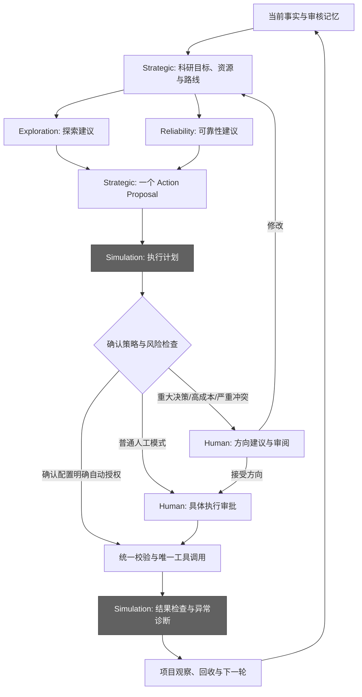

# 四 Agent 科研架构

保留现有 LangGraph、项目数据格式、科学后端和唯一执行链。新职责是 Exploration、Reliability、Strategic、Simulation，不增加 Agents SDK 或另一套调度框架。

两位专家按需、各最多咨询一次，使用同一不可变快照；互不读取另一方意见。Strategic 负责最终策略，不由专家或模型授予执行权。普通问答不强制启动团队。已有草案且无专家意见、事实未变时直接复用草案，避免重复模型调用。

Simulation 的智能体现在模型根据具体动作生成结构化任务计划，以及在工具失败时基于实际返回证据诊断。其执行能力来自已有注册工具，参数、目标和预算由原提案冻结。计划只能包含前置检查、一次 invoke 和结果验证；描述多个子任务不等于批准多个科学动作。确定性校验、回执和任务状态提供执行事实，模型不得自行宣称计算完成或重试。成功返回只表示本次工具调用完成，输入准备、提交与科学结果完成仍分别判断。

## 代码入口

| 职责 | 位置 |
| --- | --- |
| 专家咨询与最终策略 | agents/strategic/agent.py；graphs/decision_team |
| 人工方向契约 | agents/strategic/human_review.py |
| 执行计划与诊断契约 | agents/simulation/contracts.py、agent.py |
| 计划、审批、校验、工具、检查、入账 | graphs/actions；tools/workflows/run_tool_step.py |
| 原生 Codex 团队 | agents/strategic/codex_team.py；runtime/codex/team.py |
| 项目生命周期与等待恢复 | graphs/project；graphs/recovery |
| 工具/科学操作注册 | tools/dispatch/create_tool_registry.py、scientific_operations.py |

Runtime 保存客户端、manager、锁和回调；State 仅含可序列化事实。项目持久主图的节点名称、线程身份与恢复协议保持原有约束。新增 Simulation 节点位于无检查点的单动作图中；人工暂停复用外层待审方案与原生审批数据库，不在无检查点图内直接 interrupt。

## 职责、Action 与权限

| Agent | 输入与输出 | 权限边界 |
| --- | --- | --- |
| Exploration | 同一 Scientific State → 覆盖度、多样性、重复与 MC/Relax 证据、探索候选及成本/收益 | 建议已有 generate_branches、allocate_mlip_mc、prepare_mlip_relax/mc 等；不提出 DFT/训练、不判断全局终止 |
| Reliability | 同一 Scientific State → 能量/力误差、QBC、D/H OOD、near-hull 排序风险、风险结构与更新建议 | 建议已有 select_dft_candidates、prepare_dft_inputs、prepare_mlip_training 等；不决定 Branch；高不确定性不能直接推出需要微调 |
| Strategic | 两位专家独立意见、目标、资源、审核记忆及人工建议 → 最终 Proposal、取舍、优先级与可选研究路线 | 唯一最终科学提案者；决定继续/暂停/结束；不重复专业分析、不直接执行 |
| Simulation | 已冻结策略、注册工具、任务状态 → 执行计划、结果检查、证据诊断与恢复建议 | 唯一执行角色；不自行改变策略、目标或预算；越界恢复上报 |

沿用 tools/dispatch/scientific_operations.py 的实际 operation 名称，没有引入示例中的大写 Action 集合。Tool 是具体 Python 能力，Action 由现有 action_type/tool/operation/parameters 契约描述，Execution 是通过验证、授权和回执后的实际调用。agents/permissions.py 在现有注册表上声明角色权限；专家 JSON 逐项校验角色、操作、可见目录与证据。读范围是应用层投影，不是新的操作系统沙箱。

Strategic 可附 research_plan（最多 8 步，已有 operation、优先级、理由、成本和前序依赖）。第一步是唯一 active_step，必须绑定本次 Action；后续步骤只表达路线，不能批量执行或继承授权。下一轮用更新后的事实重新评估。各角色使用结构化 JSON；旧未携带扩展字段的合法协议保留。

Simulation 复用现有 MC、Relax、DFT、MLIP 推理/训练、凸包重建及远端提交/观察/回收适配器。模型计划组织执行与检查，实际科学算法、HPC 协议、资源账本和错误恢复仍由已有工具完成。失败诊断只引用观察；没有自动诊断后循环重试或另建 HPC 调度器。

## 人工意见、记忆与恢复

重大决策、严重专家冲突、敏感操作或超过已配置成本阈值时请求人工介入。支持方向审阅的项目模型客户端先收集方向意见；接受后仍需批准具体执行方案。普通人工动作只走原有执行审批，不额外增加方向轮次。文字建议通过原提案修订链形成新版本，旧批准不继承。旧 callable、旧待审方案不强行插入新的模型请求或方向轮次。

自动授权仅来自已确认配置的 workflow.auto_approved_operations，默认空列表。workflow.human_review_relative_cost 可设置相对成本审核阈值，默认不设置；它同时检查程序估算、动作预算和当前研究步骤成本。重大决策、严重冲突及已有敏感操作规则优先于自动授权。运行时覆盖、模型输出、记忆不能自行授予权限。workflow.auto_retry_limit 默认 1：现有 restart_failed_task 动作可在明确授权内准备一个重试任务，超过范围或涉及 repair_profile 参数修改必须人工审核；准备重试不等于提交 HPC。自动执行记录标注 confirmed_policy，不伪造人工同意。

Simulation 计划在审批前写入 raw_action._simulation_plan，并随方案哈希冻结。批准时复用计划；参数等发生变化后必须重新规划和审批。模型规划失败不静默降级成执行，诊断失败保留原工具失败和需人工核对状态。回执不允许借诊断或重复批准重放工具。

短期记忆是当前事实和有限会话记录；长期知识需证据检查与独立人工审核。知识检索区分项目身份和来源项目，显式处理相/相集合、动作和模型范围；未知适用条件拒绝。审核时重新核对证据存在性、状态与摘要。旧的无来源内联记录仅按当前状态文件的历史本地记录读取。记忆读改写与科学流程共用生命周期锁，不增加独立数据库。

## 文件与训练交接

ordering-search 输入和回传复用 transfer_bundle 的清单、SHA256、容量与安全解包。远端运行 export_ordering_result.py，仅回传实际消费者读取的计划、身份、结果清单、排名 CSV 与结构；不回传模型、日志、运行时代码或搜索历史。不改变排序算法。

新训练方案显式列出 handoff_scope，默认仅 manifest。包含 validation 时必须在方案中列明并接受人工审核。新任务记录绑定原训练报告、目录及交接配置；超出范围或配置改变时停止自动准备，通过 prepare_training_handoff 操作单独审批。上传/提交另行授权。升级前任务保留原历史交接契约，不对真实项目补写授权；需要收紧旧任务时由项目 Agent 提出并批准新的交接方案。

## 兼容与验证

coordinator 源码实现已迁入 strategic；保存的 phase_agent.agents.coordinator.* 描述符只经 compatibility/module_references.py 映射，不保留旧包副本。公共 MCP 命令名保持兼容，新增 phase_team_simulate。历史审批、业务账本和科研数据不迁移或删除。

本次验收记录见 [四 Agent 验证](four-agents-validation.md)。科学算法有效性、真实 API、原生客户端现场调度与真实超算结果不由合成测试替代。
