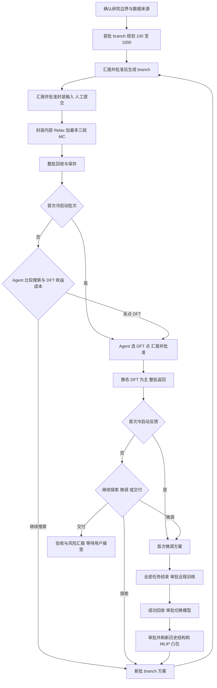

# 主动学习相图搜索流程与 Agent 决策规则及生产源码对照

确认日期：2026-10-16。状态：讨论结论整理与只读源码审查，尚未实施代码变更。

本项目以获得可靠的零温组成相图为主目标。搜索相图、候选排序和相图变化判断统一使用当前版本 MLIP 的能量；DFT 负责检验与微调，不向正式相图替换能量，不用 DFT 校正综合图决定搜索方向或收敛。Agent 比较不同动作对相图可靠性的预期收益与成本，用户逐阶段批准，现有科学封装执行计算。

本文以本次对话最后确认的规则为准。源码对照根目录为 `E:/jupyter notebook/1-AL_for_PhaseDiagram/Process_PhaseDiagram`，唯一生产包为 `phase_agent`；当前工作区中的旧 `*_layer`、顶层旧入口和历史备份不作为生产实现依据。源码默认值不等于任何具体项目已经确认的运行配置；本次未连接真实项目服务或读取其当前进程内状态。

## 1 最终约定与替代关系

1. 正式相图由 MLIP 确定，DFT 是准确性与关键排序的外部检验。之前关于“DFT 优先、MLIP 校正补充”的综合相图方案已被替代。
2. 不同 TM 配比分别维护相图和项目模型。不跨项目共享 MLIP、模型状态、预算、审批或任务；DFT 数据共享为可选项，由用户指定来源项目。
3. 每个 branch 生成批次的规划范围为 100–1000。Agent 根据证据选择数量和范围，首轮倾向充分覆盖；不是每次都填满 1000，也不是每个 MLIP 轮次累计只能生成 1000。
4. 优先探索小超胞，再按收益和成本扩展大超胞；不把“所有小超胞已穷举”作为扩展前提。
5. 科学计算不设作为停止原因的预算上限。保留成本估算、实际用量、并行资源与文件安全约束；不能因为参考预算不足而隐性截断候选或停止科学搜索。
6. 同一模型轮次内 MLIP 固定。微调前所有现有任务必须结束；微调成功后切换并刷新历史结构与凸包，不再由 Agent 重新决定是否保留旧模型。
7. 正常阶段汇报后等待用户批准下一项动作。Agent 可以准备完整可审阅方案，但提案不等于执行授权；批准复用原方案，不再请求模型重新选择动作。
8. 沿用 Relax 加最多三段 MC 的封装。Agent 不调控内部步数、分层晋升或内部停止。封装内部不逐段审批；对封装之外的新科学动作另行审批。

## 2 术语和状态边界

| 名称 | 含义 | 不能混同的对象 |
| --- | --- | --- |
| 项目 | 固定研究目标、元素体系和具体组成边界的独立工作空间 | 不是跨项目共享的模型或状态 |
| 模型轮次 | 使用同一个 MLIP 版本进行的一段搜索，直到下一次模型切换 | 可以包含多批 branch 和多批 DFT |
| branch 生成批次 | 一次经过批准的 branch 生成，规划 100–1000 个 | branch 数不等于结构文件数；同 branch 可有多个初态 |
| Relax-MC 批次 | 一次封装执行，先 Relax，再按已有规则最多三段 MC | 不保证每个 branch 都运行满三段 |
| DFT 批次 | 一次批准的 DFT 选样及对应任务 | 未回传不是失败，部分返回不等于整批完成 |
| 完整反馈循环 | 搜索、该次 DFT 全部返回、证据分析与当前 MLIP 相图状态比较 | 停止规则的一轮，不要求必须发生微调 |
| 对话回合 | 一条请求及其答复，最多推进一个已批准科学动作 | 不是模型轮次，也不是科学收敛次数 |

生成数量是规划值。有限合法空间、去重或生成失败导致实际不足时，应报告实际数量、原因和下一步方案，不能伪造数量或自动追加计算凑数。

## 3 完整流程

### 3.1 初始化

用户确定元素体系、TM 配比、组成和阳离子含量范围、候选相与竞争相、允许结构、超胞上限、计算参数、模型来源及已有数据。先沿用现有配置、合法性检查、去重和模型文件校验。

开放搜索仅发生在已确认的研究边界内，不扩展元素体系或研究目标。人工交互目前只修改超胞上限；修改先记录为待生效要求，当前任务全部结束后生效，不改变已经批准或提交的任务包。Agent 可以提出提高上限的理由，但不能自行突破。

DFT 共享默认关闭。用户指定来源后，沿用已有计算协议、TM 配比和当前边界的兼容性检查，保留来源及数据身份。共享库中新出现的数据在下一次审批时才纳入，不改变已批准方案。允许引用的 DFT 不等于已经获得本项目模型的独立验证结果。

现有引用数据启动接口还提供“先用参考 DFT 微调”或“直接使用原始模型”的选择。该能力保留为用户启用引用数据后的可选启动分支，不自动替用户选择，不把它混同于跨项目复制模型，也不改变下文默认的第一轮冷启动流程。[S30]

### 3.2 第一模型轮次

1. Agent 根据边界、有效经验和已有证据，提出首批较充分的 branch 方案，规划 100–1000 个，优先小超胞，列出范围、策略、理由及成本估算。
2. 用户批准后生成并登记 branch，汇报实际数量、覆盖分布、去重和失败情况，提出下一项 Relax-MC 输入准备方案。
3. 用户批准后生成现有封装的输入、脚本和上传清单；沿用人工上传及提交超算的工作方式。
4. 封装先 Relax、再最多三段 MC，按已有规则分配和停止；固定本轮模型。整批任务完成或明确失败后回收，保存实际计算量和候选结果。
5. Agent 从已有合法候选中选择 DFT 点，说明相图验证、模型补盲、覆盖或独立抽查目的。用户批准后准备 DFT 输入；默认静态计算。
6. 本批 DFT 全部返回后整理误差、关键相排序、数据质量和本批收益，汇报并提出首次微调方案。
7. 第一轮作为冷启动闭环，正常路径进入首次微调；已有任务未结束、合格数据不足、五折独立来源不足或计算失败属于需要报告的前置问题，不自动降低科学条件或启动训练。
8. 用户批准微调输入准备，训练在原有远程环境执行。训练成功回收并完成执行有效性检查后，展示模型切换动作供用户批准；切换后提出历史结构刷新方案，再审批执行。刷新完成后建立新模型相图和比较基线，进入下一轮。

这里的“训练成功后切换”是科学路线已经确定；不取消用户的阶段审批，也不把训练文件生成、超算提交、训练完成、模型切换和结构刷新合并成同一个未经展示的动作。

### 3.3 第二轮及后续模型轮次

1. 先依据新模型刷新已有结构和 MLIP 凸包，不能将旧模型能量直接改版本号继续使用。
2. Agent 根据历史搜索收益、DFT 暴露的问题和覆盖缺口，提出下一批 100–1000 个 branch；用户批准后生成、再审批准备 Relax-MC 输入。
3. 完整 Relax-MC 批次回收后，Agent 在两条路线中比较：继续生成 branch，或对已有候选采点 DFT。DFT 不是每个搜索批次都必须进行。
4. 若继续生成，汇报比较依据与方案，批准后返回步骤 2；同一 MLIP 内可以连续进行多批搜索。
5. 若选择 DFT，批准后准备输入，待整批全部返回后分析；再在下表三条主路线中选择。

| DFT 返回后的路线 | 适用依据 | 后续动作 |
| --- | --- | --- |
| 继续探索 | 现有模型下新增 branch 的预计发现或消除盲区收益，相对成本更有利 | 保持 MLIP，审批后生成新批 branch |
| 微调进入下一轮 | 新 DFT 已提供有价值的误差和训练证据，更新模型比继续搜索更值得 | 停止追加任务、等待现有任务结束、审批训练、切换与刷新 |
| 收敛交付 | 数值验收、关键 DFT 检验与剩余风险评估均支持停止，继续搜索或微调的预期收益不足 | 提交证据、局限及交付建议，由用户最终接受 |

如某批 DFT 无效或尚缺必要排序证据，可以提出补充 DFT 方案；这是修复证据缺口，不是强制引入第四条无限循环的主路线。所有新动作仍需批准。

图中的审批节点表示执行边界；异常和数据不足先报告用户，不借图中箭头自动执行后续动作。

## 4 Agent 决策规则

### 4.1 决策职责和输入

Agent 选择搜索区域、生成策略和数量、DFT 候选及目的，以及继续搜索、微调和交付的路线。能量、Ehull、误差、结构合法性、失败率、实际用量和验收条件由程序计算或读取已有记录；Agent 不生成这些科学数值。

默认先看当前状态和增量摘要，按需读取候选、相图、DFT、历史动作和经验。摘要必须绑定当前模型、配置、相图和数据版本；不足的证据标记未知。QBC 是模型间分歧，不是真实误差；候选池覆盖也不是全部物理空间的覆盖。

| 决策点 | 比较内容 | 必须解释的内容 |
| --- | --- | --- |
| 生成 branch | 小超胞与大超胞、低能区域跟进、组成空白和竞争结构探索 | 为什么选该区域、策略和数量；预计得到什么；为何其他方向暂缓 |
| MC 回收后 | 再生成 branch 与已有候选做 DFT | 新发现机会、模型可信程度、重复率、等待时间及计算成本 |
| DFT 选点 | 相图检验、模型改进、覆盖及独立抽查 | 每个候选的主要目的、与已有数据的互补性，不能只按 QBC 高低选 |
| DFT 返回后 | 继续探索、微调、收敛交付 | 实际发现、误差和排序证据、两类动作的预期收益与成本、未选路线原因 |

收益统一指向相图可靠性：发现新稳定结构或相、修正关键排序和相界判断、降低关键区域的不确定性。新增 branch 数量、模型平均误差下降和覆盖增加只是支撑证据，不自动等于科学收益。

比较允许定性分级，不编造精确“期望收益”。微调收益可依据新增 DFT 暴露的问题、数据覆盖和历史微调效果估计；继续搜索可通过一小批 branch 试探。试探仍直接走已有 Relax-MC 封装，Agent 不新设计阶段筛选链。历史动作结束后记录实际结果，与原先预期对照，供后续决策引用。

### 4.2 候选和 DFT

沿用封装实际输出和现有候选筛选。Agent 原则上只从当前模型的已登记、文件存在、相识别和能量证据有效的候选中选，不自行制造候选，不逐帧筛轨迹。当前生产入口按 branch 最新 MC 段的一个回收结构构造候选；完整 pool 另有保留。此次没有确认将全部 pool 全部放入正式 DFT 入口，不应借整理文档扩大候选范围。

默认 DFT 静态计算。只有同时满足“会影响相图判断”和“有结构未充分优化的证据”时，Agent 才比较收益和成本，考虑 Relax。高 QBC 或能量接近本身不足以自动触发 Relax。少数 Relax 若发生实质结构转变，最终结构和原候选分开记录，不能算原几何结构已被同帧验证。

用于正式决策的 DFT 批次保留不依赖低能/QBC 排序的独立抽查；通常至少一个，极小批可跨批累计，但交付不能缺独立抽查证据。已有相覆盖和多样性方法继续使用；不将参考选样分数升级为替代 Agent 的强制动作选择器。

### 4.3 预算与执行资源

可靠相图优先于成本最小化；不设科学成本硬上限。超参考成本时必须说明证据缺口、预计收益和新增成本，在下一步方案中交用户批准。该约定不取消超胞硬上限、单次封装资源范围、并行资源配置、运行时间安全限制、输入完整性或审批权限。

成本报告优先使用任务/GPU 作业数量及有依据的耗时。没有可靠耗时就说明未知，不把排队时间、串行累计时长和实际并行完成时间混为一谈。LLM 的查询次数、token 和耗时需独立控制，不能因为科学预算不封顶而无限扩展交互。

## 5 相图与收敛验收

### 5.1 MLIP 相图

同一相图只使用一个当前 MLIP 版本，固定 TM/O₂ 配比，在已确认 Na 范围构建组成凸包。沿用现有 eV/O₂ 归一化及 Ehull 的 eV/atom 输出。不同 TM 配比独立建图，不据此声称已处理跨 TM 配比的多元分解竞争。

DFT 回传用于误差和排序检查、训练数据与选点反馈，不把 DFT 能量直接写入正式 MLIP 凸包，不用综合图或纯 DFT 图替代正式停止依据。旧综合图和历史产物可以保留为历史/诊断资料；不能继续以它们驱动当前正式决策，也不能因停用而删除历史结果。

切换模型后重新评价已有结构，沿用现有分层刷新：原基态 Relax，近凸包和历史重要结构评价，远端结构抽查，必要时一轮补充刷新。这里是新模型的 MLIP 计算，不是默认增加 DFT Relax。部分刷新不能宣称全局证据完备；新轮建立本模型自己的相图比较基线，不跨模型直接比较绝对能量。

### 5.2 交付条件

| 条件 | 最终约定 |
| --- | --- |
| 活动任务 | 当前批次及模型切换相关任务全部结束，未知状态不能当作成功；失败如实登记 |
| 稳定循环 | 一个完整搜索—DFT 反馈循环内，当前 MLIP 相图变化足够小且没有新稳定相/结构出现 |
| 相图变化容差 | 使用项目已确认且单位明确的容差；本次未重新给出最终数值。生产源码默认 0.003 eV/atom，不误写成已确认的新阈值 |
| 基态验证比例 | 当前 MLIP 凸包上去重稳定结构中，超过 60% 有对应合格 DFT 检验；不以同组成其他结构代替 |
| 能量误差 | 当前模型未训练过的新 DFT 同帧验证，能量 MAE <5 meV/atom |
| 力误差 | 同一独立验证范围内，原子笛卡尔分量的力 RMSE <50 meV/Å |
| 关键竞争相 | DFT 与 MLIP 的关键排序不能存在未解决冲突；冲突触发补证据、继续探索或微调，不用 DFT 能量替换图绕过问题 |
| 覆盖与局限 | 对当前已定义的组成、结构族和超胞层级说明覆盖与盲区，不宣称穷举开放空间 |
| 最终决策 | Agent 比较继续探索与微调的收益成本后提出交付建议，用户明确接受后结束 |

DFT 检验比例和独立误差是两件事：历史 DFT 若几何及协议匹配，可作为某结构已有检验记录；但若已参与当前模型训练，不能计入本模型独立误差验收。五折结果作为训练评估辅助，不能冒充最终模型未见数据测试。

尚无数值结论或遗漏关键候选时，输出“证据不足”而非“收敛”。覆盖率分母来自明确研究单元，不能定义为未知全部结构。最终交付为“MLIP 预测相图，附 DFT 检验证据”，不是纯 DFT 相图或有限温自由能相图。

## 6 交互 记忆与经验

### 6.1 汇报与审批

沿用已有简短模板：项目和当前模型轮次/批次状态、本次发生的事、结果、下一步、任务量和预计耗时。branch 生成、MC 整批回收、DFT 回收、微调完成和刷新均提供对应结果；详细表格、文件路径、误差图和证据按需展开。

正常汇报后等待批准。输入准备不等于提交超算，“继续”不等于批准。批准绑定方案修订、范围、模型、配置和输入身份；修改方案后重新批准。可以在汇报时主动形成下一项具体方案，不额外询问“是否开始分析”。不得以包内自动推进为理由扩大到 DFT、训练或新批 branch。

DFT 和 MC 正式决策等待本批全部任务结束；允许中途回收保存和状态答疑，不据部分返回切轮。用户若明确放弃等待，需另行记录具体任务和未知状态，不能把放弃等待伪装成全部计算结束，尤其不能据此绕过微调等待屏障。

### 6.2 有限上下文与长期事实

沿用会话短记忆、持久项目台账、模型/配置版本、动作和收益记录、执行回执及审批记录。短记忆只提供语义背景，不授予权限，也不承担唯一科学状态存储。

默认先给摘要和证据目录，按需读取详细证据，避免每次传全部任务、候选、配置和轨迹。沿用已有压缩、相同请求缓存、token 用量和耗时记录；当前事实变化必须使旧摘要或缓存失效。候选决策需要的合法候选全集不能因省 token 而被静默抽样丢弃。

Agent 在有新证据或确有决策需求时调用；纯轮询、文件回收、保存及简单批准重用不增加科学推理调用。每次调查使用有限的查询、token 和时间范围；不能以节省 token 为由捏造结论。失败直接通知用户，不自动重试、自动修复后重发或静默切规则决策；用户明确重试是新请求。

### 6.3 经验引用与提取

沿用现有有效经验检索、近期行动反馈和收敛后的经验草稿机制。经验须带来源、适用范围和证据，区分观察与假设；当前明确指令、最新科学事实和审批高于历史经验。经验可以推荐搜索方向，不共享模型或继承其他项目权限。

收敛后的经验提取形成可审阅草稿，发布到共享经验库仍需用户批准。本次未授权自动发布，也未要求额外建立每批独立经验模型；过程经验先进入已有动作/收益记忆。

## 7 异常规则

- Agent 调用、解析或决策失败：直接向用户说明，停止新增科学动作；原有计算继续，程序按原有机制保存、回收。不静默回退。
- 个别 DFT 失败：登记失败并放弃，不自动重试。未返回只记等待或未知，不计成失败。
- 集中 DFT 失败：超过 50% 是重要异常信号，Agent 结合数量、比例和共同报错判断，逐批汇报并等待用户；不自动改 DFT 参数或重提整批。该比例是异常处理信号，不是收敛门槛。
- 封装阶段失败、缺有效凸包或结果校验失败：沿用封装暂停和防重复提交规则，通知用户；不跳过错误继续后续 MC。
- 微调失败、模型无法加载/文件身份不匹配：保留旧模型和所有历史结果。训练成功的执行有效性检查，与“误差必须改善才准切换”的科学门槛分开。
- 数据少于现有训练前置条件：通知并提出可审阅的补数据路径，不自动降低五折来源要求、不用训练误差替代独立检验。

## 8 源码对照方法

以下分为“已有实现直接沿用”“需要修改”“需要补齐”。同一模块可以部分沿用、部分调整；函数存在不等于所有主路径都符合。引用指向生产源码，行号对应本次检查快照。

配套[源码快照](/C:/Users/Esseco/Documents/ChatGPT/AL_for_FM/docs/workflow-agent-source-snapshot-2026-10-16.json)记录生产包 656 个 Python 文件的 SHA256，用于后续确认源码是否变化。它不是运行测试报告。没有实际运行 API、DFT、MLIP、HPC 提交或项目服务；本次结论来自静态源码和调用链，不承诺线上当前服务已经加载这些源码。

### 8.1 已有实现直接沿用

| 编号 | 已有实现 | 复用边界与证据 |
| --- | --- | --- |
| R01 | 唯一项目生命周期图、单动作审批图、持久等待/恢复 | 保留原图和状态，不恢复旧 scheduler。项目 observe/analyze/react 与执行图已经分开。[S01] [S02] |
| R02 | 具体方案审批、修订和输入准备权限 | 普通批准只授权本次动作；输入准备不授予提交权，区域生成可单独停止。沿用身份及防重，调整处见 M08。[S03] |
| R03 | Relax 加最多三段 MC 封装 | 远程按整阶段完成再推进；固定分层策略、失败暂停、返回归档、无盲目重提。不是前文误引的旧 [10,30,90] 三档配置。[S04] [S05] [S06] |
| R04 | 单 TM 配比、Na 组成凸包与能量单位 | eV/O₂ 归一化，当前数据两端最低能参考线，Ehull eV/atom；不自行换参考态或扩成多元 hull。[S07] |
| R05 | 已有 MC 后 DFT 候选入口 | 当前模型、每 branch 最新段回收结构、有效文件、相识别和相图匹配、唯一 ID 检查，沿用当前选择范围。[S08] |
| R06 | DFT 分类与基本合法性校验 | 单点优先、Relax 数量限制、未知候选/重复/非法参数校验继续使用；Relax 证据门槛和独立审计待补。[S09] [S10] |
| R07 | 累计合格 DFT 数据、自旋标准、五折训练和远程输入 | 历轮合格数据累积，五折按来源分组，主模型复用委员会成员，训练仍在配置的远程环境。[S11] [S12] [S13] |
| R08 | 微调等待已有任务结束 | 正式 update_mlip 入口检查 active_tasks 和新增数据条件，已有屏障保留并覆盖所有切换路径。[S14] |
| R09 | 模型版本、旧结果失效和结构刷新 | 保留旧相图，现有基态 Relax/近凸包预测/远端抽查与最多一轮补充规则继续使用，不全量重建算法。[S15] [S16] [S17] |
| R10 | 建议预算与实际成本账本 | 默认 advisory，保留估算、预留、用量及未知成本；推荐器截断另见 M07。[S18] [S19] |
| R11 | 简短汇报、审批摘要、DFT 批次分析 | 不另造模板；修改正式相图展示和训练后方向等内容，见 M01/M05。[S20] [S21] [S22] |
| R12 | 会话短记忆和版本化科学上下文 | 最近 6 轮、读取上下文约 10000 字符；检索有效知识默认 limit=8、token_budget=2000。持久事实与短记忆分离。[S23] [S24] |
| R13 | API 超时、token 统计、同请求缓存 | 现有总时限、usage 和缓存保留；自动重试/修复不符合当前偏好，见 M06。未做真实性能测量。[S25] [S26] |
| R14 | 同帧 DFT 误差与关键竞争相验证 | 能量每原子和力分量 MAE/RMSE 计算保留；接入未训练数据资格筛查，见 G02。[S27] [S28] |
| R15 | 跨项目只共享 DFT 标签的基础设施 | 无模型/旧 Ehull 共享，校验协议、TM 配比和边界；现有自动导入与可选来源不一致，见 M09/G05。[S29] [S30] |
| R16 | 经验检索、草稿和批准发布 | 经验匹配、有效知识引用、收敛后经验草稿及显式批准发布均有代码；保持来源、限制和审批。[S24] [S31] [S32] [S33] |
| R17 | 数值满足后用户最终接受 | 现有收敛器区分 numerical_criteria_satisfied 与用户接受后的 finished；只改证据与计数，不去掉人工接受。[S34] |

### 8.2 需要修改现有实现

| 编号 | 实际源码现状 | 与确认流程的差异 | 修改方向 |
| --- | --- | --- | --- |
| M01 | 回收分析刷新 combined 图，汇报显示综合图；收敛记录有 DFT 图就优先 DFT，否则 MLIP | 正式相图已改为纯 MLIP | 决策、收益、收敛、默认导出和汇报统一选择当前模型 MLIP；历史综合图只保留诊断身份。不要删除旧产物。[S35] [S22] [S36] |
| M02 | 新提案使用 region-adaptive-v2，禁止 quota/total_quota，生成数量是结果；旧 100–1000 模块仍存在 | 与每批规划 100–1000 冲突 | 保留已有区域表达、合法生成与去重，但新提案统一执行已确认数量策略；不要只修改旧模块而遗漏默认新路径。[S37] [S38] [S39] |
| M03 | 收敛器按不同 model_version 的 model_update_epochs 计数；同模型 MC/反馈只更新原 epoch | 稳定一轮应为完整反馈循环，不强制更新模型 | 保留模型 epoch 做来源记录，另按完整搜索/DFT 批次结束证据计稳定循环；同模型有新反馈才计，不因重复“继续”累加。[S34] [S36] |
| M04 | 当前 hull_change 为共同 structure_id 的最大 Ehull 差，稳定判据按稳定 ID 集合；源码默认能量 MAE 3 meV/atom，力门槛默认关闭 | 必须同模型基线；交付改为能量 <5、力 RMSE <50，稳定结构和新相不能因 ID 差异误计 | 限定 MLIP、模型版本、可比组成范围及完整批次；保留当前数值计算作基础，补身份/新相证据与明确单位；配置 0.005 eV/atom、0.05 eV/Å，并处理严格小于边界。相图变化容差另按项目确认值。[S34] [S36] [S40] |
| M05 | 训练回传后 Agent 再比较 activate/supplement_dft；CV 注册要求新旧能量及力 MAE/RMSE 都不恶化；其他入口也有验证通过/收益判定 | 已定微调正常成功后切换，最终独立验收另做 | 训练后不再重做科学方向选择；保留模型产物与文件有效性、用户切换审批、训练失败保留旧模型。梳理 CV/远程/通用处理器，不能仅绕过单一 gate。[S41] [S42] [S43] [S44] |
| M06 | 客户端对部分空响应/超时等有限重试，训练 review 和部分结构化决策还会二次请求修复 | 用户要求失败直接告知 | 统一失败出口，停止静默重试、修复重发和规则代选；保留已发生用量、未知 usage 与执行防重。未调用用户不能据缓存失败继续执行。[S25] [S41] [S45] |
| M07 | 全局预算默认 advisory，但 DFT 推荐器仍按参考成本、每轮/阶段数量和余额裁剪候选 | 不设科学预算门槛不能只改总预算检查 | 在建议模式下把这些值作为工作量说明而非隐性候选截断；保留用户已批准批次范围和执行资源限制，核对所有候选推荐/文件准备入口。[S18] [S19] [S46] |
| M08 | 新 branch 有独立生成审批，也存在 branch+输入准备的 module_execution_scope 授权包络 | 用户要求生成结果先汇报，下一步等批准；包内 MC 不另审 | 正常流程采用生成登记后停止、另审封装输入；旧的明确已批准包络按原身份保留。不要取消封装内部自动推进。[S03] [S47] |
| M09 | 回收时 publish/import/reusable_results 自动访问所连接共享库；入口按体系和协议选数据而非来源白名单 | 默认不共享，指定来源，新数据下次审批纳入 | 在已有共享入口增加启用、来源过滤与数据快照边界；不修改历史已批准训练包，不因开关变化重写既有模型和数据来源。[S29] [S35] [S48] |
| M10 | DFT 部分回收会询问是否继续等，用户可标记 recovery_wait_waived | 默认要求全部返回再正式决策，真实在跑的任务不能因此绕过微调等待 | 保留明确人工处置与异常恢复；正常不主动把部分返回升级为完成。区分等待豁免、确认终态和实际仍运行，应用到训练与验收屏障。[S49] [S50] [S14] |

### 8.3 需要补齐现有链路中的规则或证据

| 编号 | 缺口 | 可复用位置与补齐要求 |
| --- | --- | --- |
| G01 | MLIP 基态结构 DFT 检验比例 >60% 的交付证据 | 本次检查的正式收敛器未见该条件。基于当前稳定结构、几何身份、合格 DFT 与去重关系计算，不能用训练数据总数/全部候选验证率替代。[S34] [S27] |
| G02 | 当前模型未训练过的新 DFT 独立验收资格 | 当前 single_point_validation 按模型版本和 stage 筛选，未见按当前模型训练数据身份明确排除。结合训练数据快照、DFT 来源和模型注册表建立可追溯资格；CV 与训练误差分开。[S28] [S11] [S13] [S43] |
| G03 | Agent 最终 DFT 批次的独立抽查保证 | 推荐器有随机抽查，但 round(batch_size*fraction) 可为 0，相覆盖或成本筛选也可能挤掉；最终 Agent 校验未见抽查保证。复用已有独立抽样机制，记录当批/跨批抽查证据，提交方案时校验。[S10] [S51] |
| G04 | DFT Relax 的双重证据和取舍校验 | 已有限制 Relax 数量，但尚不足以保证“影响相图且有结构未充分优化证据”。复用数值残余力/应力、相竞争和 Agent 理由，校验必要证据，不能把 QBC 高自动等价为要 Relax。[S09] [S10] [S27] |
| G05 | 可选共享的来源项目名单与审批数据快照 | 共享库记录来源和数据 ID 已有；补启用、允许来源、具体纳入 ID/指纹及下一次审批确认。已有严格兼容检查直接沿用；不自动放宽到不同 TM 配比。[S29] [S48] |
| G06 | 超胞上限修改的待生效与排空边界 | 已有配置版本、冻结包和生成范围检查。本次定向检查未确认统一的“只改上限→等待当前任务结束→生效”路径；实施前沿配置调用链核实，已有能力则复用，不另造并行配置器。[S04] [S37] [S39] |
| G07 | 小超胞优先的跨批搜索记忆与解释 | 现有区域 priority 和合法 H 范围可复用；尚未确认在线决策统一表达该优先级及扩大理由。补有证据的优先顺序和历史结果引用，不新增强制穷举规则。[S37] [S38] [S24] |
| G08 | 第一轮冷启动与后续自由分岔的明确状态 | 通用提示已描述闭环，但未找到专门保证“首轮 DFT 后首次微调”的统一阶段记录。沿现有项目图和动作记录表达，正常首轮不默认为普通后续方向判断；真实前置不足先报告。[S01] [S38] [S14] |
| G09 | 集中 DFT 失败比例和逐批异常摘要 | 已有回收事实和失败溯源，补超过 50% 信号、数量和共同报错供 Agent 判断；只报告和提案，不自动重试。不能把未知回传算失败。[S50] [S52] |
| G10 | 政策长记忆与调用预算的统一生效核查 | 已有短记忆、科学策略、摘要取证、API 总时限和 token 记录；本次未证明全部路径都一致执行“无新证据不重复推理、失败零自动重试”。沿现有路径补覆盖核查和用量可见性，不新建平行记忆系统。[S23] [S24] [S25] [S26] [S45] |

“需要补齐”表示在本次定向检查的生产路径中未见完整闭环，不宣称全仓没有任何相关函数。后续若找到同一职责的已有实现，应补接或复用，并更新此分类。

## 9 后续对齐顺序与验证要点

本节仅列后续实施依据，不授权本次改代码或运行服务。

1. **先统一科学口径**：MLIP 唯一正式图、同模型完整反馈循环、>60% 结构检验、独立新 DFT 的 5/50 门槛。先修正提示、状态事实、数值检查和默认汇报之间的冲突。
2. **再统一路线与授权**：首轮冷启动、后续两个决策分岔、微调成功后的切换、branch 100–1000、小超胞优先、生成与封装的审批范围。
3. **再处理证据和边界**：共享来源及数据快照、修改超胞上限的生效屏障、DFT 独立抽查和 Relax 必要证据。
4. **最后统一交互实现**：停止自动重试、去除重复推理、保持现有短模板与经验库，检查全部调用的 token 和耗时统计。

后续使用假模型、假文件与假超算进行有意义的针对性验证：

- 新 DFT 不改变正式图的能量来源，DFT 排序冲突仍阻止错误交付；旧综合图不参与当前决策。
- 不微调也能以新的完整反馈循环计稳定；重复读取同一批结果、模型切换前后基线和部分回收均不错误累计。
- >60%、5 meV/atom、50 meV/Å 的边界、单位、结构身份和未训练资格被正确区分；已训练/共享训练数据不混入独立验收。
- 100–1000 是 branch 规划数；与 POSCAR 数不同；不足如实报告。新默认 region 路径也遵循最终数量规则。
- 科学参考预算超出只产生说明，不暗中删减候选；超胞上限和审批身份仍严格执行。
- 封装一次批准的范围内最多三段 MC；失败不重复提交。封装以外的新动作必须等用户批准。
- 微调/切换等待真实活动任务结束；数据不足与文件无效明确失败；训练误差不作为最终交付误差。
- 共享默认关闭，只取允许来源、兼容数据及已批准快照；来源新增数据不改变旧方案，外部项目模型不导入。
- LLM 各类失败只发出本次失败通知，不自动重试或规则决策；已有计算与回收记录不受影响。
- 上下文和缓存随事实版本变化；审批不重选模型；经验草稿发布仍需用户批准。

## 10 源码引用索引

以下链接以本次生产源码快照为准；配套 JSON 可检测之后的源文件变化。后续实施使用项目已有 `py1` 管理/测试环境，科学后端保持原配置。

[S01]: </E:/jupyter notebook/1-AL_for_PhaseDiagram/Process_PhaseDiagram/phase_agent/graphs/project/graph.py:8>
[S02]: </E:/jupyter notebook/1-AL_for_PhaseDiagram/Process_PhaseDiagram/phase_agent/graphs/actions/graph.py:8>
[S03]: </E:/jupyter notebook/1-AL_for_PhaseDiagram/Process_PhaseDiagram/phase_agent/runtime/review_presentation.py:48>
[S04]: </E:/jupyter notebook/1-AL_for_PhaseDiagram/Process_PhaseDiagram/phase_agent/tools/relax_mc_batch/plan.py:70>
[S05]: </E:/jupyter notebook/1-AL_for_PhaseDiagram/Process_PhaseDiagram/phase_agent/tools/relax_mc_batch/dependencies.py:124>
[S06]: </E:/jupyter notebook/1-AL_for_PhaseDiagram/Process_PhaseDiagram/phase_agent/science/mc/continuation_policy.py:6>
[S07]: </E:/jupyter notebook/1-AL_for_PhaseDiagram/Process_PhaseDiagram/phase_agent/analysis/phase/build_composition_hull_entries.py:10>
[S08]: </E:/jupyter notebook/1-AL_for_PhaseDiagram/Process_PhaseDiagram/phase_agent/science/qbc/post_mc_candidates.py:7>
[S09]: </E:/jupyter notebook/1-AL_for_PhaseDiagram/Process_PhaseDiagram/phase_agent/decisions/agent/propose_tool_action.py:11>
[S10]: </E:/jupyter notebook/1-AL_for_PhaseDiagram/Process_PhaseDiagram/phase_agent/tools/workflows/validate_dft_agent_decisions.py:9>
[S11]: </E:/jupyter notebook/1-AL_for_PhaseDiagram/Process_PhaseDiagram/phase_agent/science/training/cumulative_training_records.py:8>
[S12]: </E:/jupyter notebook/1-AL_for_PhaseDiagram/Process_PhaseDiagram/phase_agent/tools/workflows/prepare_remote_finetune.py:15>
[S13]: </E:/jupyter notebook/1-AL_for_PhaseDiagram/Process_PhaseDiagram/phase_agent/science/training/prepare_main_model.py:12>
[S14]: </E:/jupyter notebook/1-AL_for_PhaseDiagram/Process_PhaseDiagram/phase_agent/tools/workflows/create_workflow_handlers.py:38>
[S15]: </E:/jupyter notebook/1-AL_for_PhaseDiagram/Process_PhaseDiagram/phase_agent/persistence/models/require_structure_refresh.py:6>
[S16]: </E:/jupyter notebook/1-AL_for_PhaseDiagram/Process_PhaseDiagram/phase_agent/analysis/feedback/model_refresh_plan.py:9>
[S17]: </E:/jupyter notebook/1-AL_for_PhaseDiagram/Process_PhaseDiagram/phase_agent/tools/workflows/model_refresh_state.py:16>
[S18]: </E:/jupyter notebook/1-AL_for_PhaseDiagram/Process_PhaseDiagram/phase_agent/tools/budget/check_budget.py:4>
[S19]: </E:/jupyter notebook/1-AL_for_PhaseDiagram/Process_PhaseDiagram/phase_agent/configuration/defaults/default_budget_rules.py:4>
[S20]: </E:/jupyter notebook/1-AL_for_PhaseDiagram/Process_PhaseDiagram/phase_agent/runtime/response_preferences.py:9>
[S21]: </E:/jupyter notebook/1-AL_for_PhaseDiagram/Process_PhaseDiagram/phase_agent/runtime/concise_dialogue.py:6>
[S22]: </E:/jupyter notebook/1-AL_for_PhaseDiagram/Process_PhaseDiagram/phase_agent/runtime/post_dft_presentation.py:8>
[S23]: </E:/jupyter notebook/1-AL_for_PhaseDiagram/Process_PhaseDiagram/phase_agent/persistence/memory/conversation.py:9>
[S24]: </E:/jupyter notebook/1-AL_for_PhaseDiagram/Process_PhaseDiagram/phase_agent/analysis/state/build_decision_context.py:19>
[S25]: </E:/jupyter notebook/1-AL_for_PhaseDiagram/Process_PhaseDiagram/phase_agent/decisions/agent/create_deepseek_client.py:204>
[S26]: </E:/jupyter notebook/1-AL_for_PhaseDiagram/Process_PhaseDiagram/phase_agent/runtime/token_usage.py:64>
[S27]: </E:/jupyter notebook/1-AL_for_PhaseDiagram/Process_PhaseDiagram/phase_agent/analysis/feedback/dft_comparison_tables.py:144>
[S28]: </E:/jupyter notebook/1-AL_for_PhaseDiagram/Process_PhaseDiagram/phase_agent/analysis/convergence/single_point_validation.py:16>
[S29]: </E:/jupyter notebook/1-AL_for_PhaseDiagram/Process_PhaseDiagram/phase_agent/persistence/shared_dft.py:25>
[S30]: </E:/jupyter notebook/1-AL_for_PhaseDiagram/Process_PhaseDiagram/phase_agent/tools/workflows/reference_dft_startup.py:12>
[S31]: </E:/jupyter notebook/1-AL_for_PhaseDiagram/Process_PhaseDiagram/phase_agent/persistence/memory/maybe_draft_converged_skill.py:10>
[S32]: </E:/jupyter notebook/1-AL_for_PhaseDiagram/Process_PhaseDiagram/phase_agent/persistence/memory/load_matching_domain_skills.py:9>
[S33]: </E:/jupyter notebook/1-AL_for_PhaseDiagram/Process_PhaseDiagram/phase_agent/persistence/memory/publish_domain_skill.py:9>
[S34]: </E:/jupyter notebook/1-AL_for_PhaseDiagram/Process_PhaseDiagram/phase_agent/analysis/convergence/check_global_convergence.py:19>
[S35]: </E:/jupyter notebook/1-AL_for_PhaseDiagram/Process_PhaseDiagram/phase_agent/tools/workflows/lifecycle_recovery.py:339>
[S36]: </E:/jupyter notebook/1-AL_for_PhaseDiagram/Process_PhaseDiagram/phase_agent/tools/workflows/apply_scientific_feedback.py:338>
[S37]: </E:/jupyter notebook/1-AL_for_PhaseDiagram/Process_PhaseDiagram/phase_agent/tools/policy/region_sampling.py:10>
[S38]: </E:/jupyter notebook/1-AL_for_PhaseDiagram/Process_PhaseDiagram/phase_agent/decisions/agent/propose_tool_action.py:22>
[S39]: </E:/jupyter notebook/1-AL_for_PhaseDiagram/Process_PhaseDiagram/phase_agent/tools/policy/adaptive_branch_count.py:6>
[S40]: </E:/jupyter notebook/1-AL_for_PhaseDiagram/Process_PhaseDiagram/phase_agent/configuration/defaults/default_layered_search_config.py:142>
[S41]: </E:/jupyter notebook/1-AL_for_PhaseDiagram/Process_PhaseDiagram/phase_agent/tools/local/training_agent_review.py:9>
[S42]: </E:/jupyter notebook/1-AL_for_PhaseDiagram/Process_PhaseDiagram/phase_agent/tools/local/training_cv_review.py:120>
[S43]: </E:/jupyter notebook/1-AL_for_PhaseDiagram/Process_PhaseDiagram/phase_agent/tools/workflows/create_model_update_handler.py:10>
[S44]: </E:/jupyter notebook/1-AL_for_PhaseDiagram/Process_PhaseDiagram/phase_agent/persistence/models/activate_validated_model.py:10>
[S45]: </E:/jupyter notebook/1-AL_for_PhaseDiagram/Process_PhaseDiagram/phase_agent/decisions/agent/post_dft_review.py:94>
[S46]: </E:/jupyter notebook/1-AL_for_PhaseDiagram/Process_PhaseDiagram/phase_agent/decisions/qbc_selection/recommend_post_mc_dft.py:8>
[S47]: </E:/jupyter notebook/1-AL_for_PhaseDiagram/Process_PhaseDiagram/phase_agent/tools/workflows/scientific_module_scope.py:7>
[S48]: </E:/jupyter notebook/1-AL_for_PhaseDiagram/Process_PhaseDiagram/phase_agent/runtime/diagram_projects.py:25>
[S49]: </E:/jupyter notebook/1-AL_for_PhaseDiagram/Process_PhaseDiagram/phase_agent/tools/state/dft_recovery_decision.py:43>
[S50]: </E:/jupyter notebook/1-AL_for_PhaseDiagram/Process_PhaseDiagram/phase_agent/analysis/state/dft_round_status.py:16>
[S51]: </E:/jupyter notebook/1-AL_for_PhaseDiagram/Process_PhaseDiagram/phase_agent/decisions/qbc_selection/select_dft_candidates.py:12>
[S52]: </E:/jupyter notebook/1-AL_for_PhaseDiagram/Process_PhaseDiagram/phase_agent/analysis/state/task_failure_facts.py:5>

## 2026-10-16 续跑补充：明确取消 DFT 回收

用户补充确认：“不再等待取消即可，不再回收，以后也是，说明情况即可。”明确关闭当前 DFT 回收问题时，取消所选未返回任务的本地跟踪，保留原状态、范围和用户理由；不将其标成完成/失败或DFT验证，不自动发送超算终止命令，不再自动接收迟到结果。批次分别报告真实返回、已取消、仍未返回；“全部返回后决策”指全部未取消任务已返回，明确取消项可解除等待与训练/切换屏障，但不补足独立误差或>60%结构验证证据。无明确关闭指令的未返回任务仍保持屏障。既有历史等待豁免不批量猜测迁移；本次仅明确授权取消FeMn三条旧DFT。原审批、输入及科学数据不重写。
